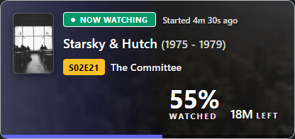
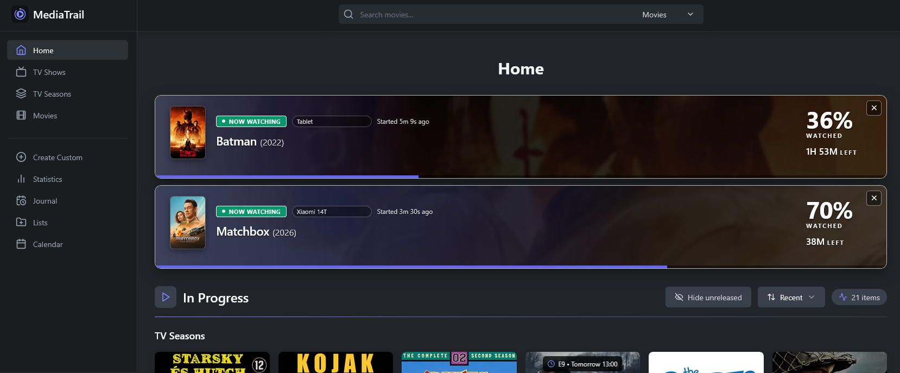

# MediaTrail

[🇭🇺 Magyar nyelvű leírás (README in Hungarian)](README_HU.md)

A self-hosted personal media tracker and digital logbook for everything you watch, read, and play.

[](https://github.com/aicon/MediaTrail/releases)
[](LICENSE)
[](https://github.com/aicon/MediaTrail/pkgs/container/mediatrail)
[](https://aicon.github.io/mediatrail-docs/)
[](https://ko-fi.com/aiconwg)

---

MediaTrail is an independent, self-hosted web application to track movies, TV shows, seasons, episodes, anime, manga, video games, books, comics, and board games in one place. Organize your library, log dates, assign ratings, track your progress, build custom lists, and explore your personal viewing statistics.

MediaTrail originates as an independent fork of [Yamtrack](https://github.com/FuzzyGrim/Yamtrack), adding essential capabilities such as an integrated REST API, rich episode watch histories, live playback tracking, Nuvio integration, and native Hungarian localization.

---

## Features

- **A record for every title:** Movies, TV shows, anime, manga, video games, books, comics, and board games. Save a score, status, and progress, count repeats, set start and end dates, and write notes.
- **Seasons and complete rewatch history:** Follow each season independently. An episode can keep several watch records, each with its own timestamp and note. Movies and TV series stay cleanly separated.
- **Journal activity feed:** Browse day-by-day what you watched, read, or played, with posters, status badges, and relative timestamps.
- **Richer statistics:** Desktop summary cards in one row, chart labels in your language, plus In Progress, % Rated, and consumption breakdowns.
- **Detailed change logs:** Keep track of the steps themselves: when an item was added, when you started watching/reading it, and when you completed or rewatched it.
- **Manual custom entries:** Add custom entries when none of the supported online databases lists a title.
- **Collaborative lists:** Build personal lists for any purpose and invite other accounts to collaborate.
- **Upcoming releases & calendar:** Keep an eye on upcoming releases with an exportable iCalendar (`.ics`) link and automated Apprise notifications (Discord, Telegram, ntfy, Slack, email, etc.).
- **Multi-user with separate libraries:** Each user manages an isolated library. Authenticate locally or via social/OIDC providers (Google, GitHub, Discord) through django-allauth.
- **English and Hungarian localization:** Switch interface languages per user account. Metadata from TMDB follows `TMDB_LANG`.
- **Imports, including Nuvio:** Import profiles directly from Nuvio (add missing items or update existing ones) with encrypted credentials and scheduling. Automated sync is also available for Trakt, SIMKL, MyAnimeList, AniList, and Kitsu. Import a Trakt website export ZIP with validation and preview. Export/import your full library via CSV, or bring in data from IMDb, Goodreads, Steam, and HowLongToBeat.
- **Built-in Playback Scrobbler (Nuvio & Media Servers):** MediaTrail includes a native Stremio-protocol addon endpoint that captures playback events from companion apps without requiring a separate scrobbler container. Displays live "Now Watching" strips on your dashboard and automatically records completions. Jellyfin, Plex, and Emby can also scrobble via webhooks.
- **Preview REST API:** Full REST API at `/api/v1/`, OpenAPI schema at `/api/schema/`, and interactive Swagger documentation at `/api/docs/`. Written reference: [API.md](API.md) ([magyar](API_HU.md)).
- **Self-contained single container:** Ready-to-run Docker Compose image with embedded Redis. All data stays inside a single mounted directory.

---

## Preview: Now Watching & Built-in Scrobbler

MediaTrail includes a built-in Stremio-protocol scrobbler service. **It does not host or stream media content, nor does it provide catalogs.** It simply acts as an event sink listening for player state changes (`start`, `pause`, `progress`, `stop`) emitted by playback clients, updating your dashboard in real time.

Each companion device gets its own dedicated strip on the home page, allowing phones and multiple TVs to report active playback concurrently without overwriting each other:


*(Also available in a compact format for responsive dashboards)*



The strips sit prominently at the top of your dashboard:



### How Playback Tracking Works

- **Requires Companion Apps:** Because official upstream Nuvio apps do not emit player events, scrobbling requires our dedicated companion apps: **[NuvioTV-MT](https://github.com/aicon/NuvioTV-MT)** (Android TV) and **[NuvioMobile-MT](https://github.com/aicon/NuvioMobile-MT)** (Android phone/tablet).
- **Zero Extra Containers:** The scrobbler is embedded directly into MediaTrail. No separate bridge or scrobbler container is needed.
- **Simple Setup:** Simply add your MediaTrail addon manifest URL inside the companion app under **Settings → Addons**.
- **Multi-Device Isolation:** Each client sends a stable `deviceId` alongside an automatic label (e.g. `TV · Shield` or `telefon · Pixel 8`).
- **Custom Naming:** Rename any strip directly on the home page; custom names persist across stops and dismissals.
- **Completion on stop:** When the client sends `stop` and progress is at least **90%**, MediaTrail writes one completed watch into history. Crossing 90% while still playing does not finish the title by itself.
- **Graceful Timeouts:** `pause` and `stop` only affect that specific device's strip. If a player abruptly closes without sending a stop event, stale strips are automatically cleared after an inactivity timer.

---

## Quick Start

MediaTrail is distributed as a lightweight, pre-configured Docker container with internal Redis support.

### Docker Compose

Create a `docker-compose.yml` file:

```yaml
services:
  mediatrail:
    image: ghcr.io/aicon/mediatrail:latest
    container_name: mediatrail
    restart: unless-stopped
    ports:
      - "8000:8000"
    environment:
      SECRET: longstring
      TMDB_LANG: en
      TMDB_API:
      TVDB_API:
      URLS:
      ADMIN_ENABLED: false
      REGISTRATION: false
      # Simkl AUTH V2 (preferred for new connections; PKCE)
      # SIMKL_V2_ID:
      # SIMKL_V2_SECRET:
      # Legacy AUTH V1 (deprecated ~April 2027) only if V2 is unset:
      # SIMKL_ID:
      # SIMKL_SECRET:
    volumes:
      - ./db:/mediatrail/db
```

### Update the environment values

Open the Compose file and replace the example secret:

```text
SECRET=longstring
```

Use a long random value for `SECRET`. If you are running MediaTrail behind a reverse proxy, set `URLS` to your public origin:

```text
URLS=https://mediatrail.example.com
```

The URL must include the protocol (`https` or `http`) and should not include a trailing slash or application path. Multiple origins can be separated with commas.

#### Simkl AUTH V2

1. Open [Simkl Developer settings](https://simkl.com/settings/developer/) and create a **new** AUTH V2 app (a V1 `client_id` cannot be upgraded).
2. Prefer **Server apps & services** for MediaTrail; copy `client_id` and the one-time `client_secret`. (**Mobile, desktop & browser apps** also works with PKCE and no secret.)
3. Register redirect URI `https://your-host/import/simkl_private` (exact match to `URLS` + that path).
4. Set Compose / `.env` (prefer `*_FILE` mounts for secrets):

```text
SIMKL_V2_ID=your-v2-client-id
SIMKL_V2_SECRET=your-v2-client-secret
```

5. Recreate the container, then **Import → Connect with Simkl**. Existing AUTH V1 tokens keep working until Simkl retires V1 (~April 2027); reconnect after enabling V2 so schedules store a V2 refresh token.

Full walkthrough: [Runtime → Simkl AUTH V2](https://aicon.github.io/mediatrail-docs/runtime/#simkl-auth-v2-get-keys-and-connect). For the full settings list see [Runtime](https://aicon.github.io/mediatrail-docs/runtime/).

Start the container:

```bash
docker compose up -d
```

Open your browser at `http://localhost:8000`.

> **Note on Upgrading from Yamtrack:**  
> The internal storage path in MediaTrail is `/mediatrail/db` (replacing Yamtrack's old `/yamtrack/db`). Simply map your existing directory to `./db:/mediatrail/db`.

---

## MediaTrail vs. Yamtrack

MediaTrail is an independent, unofficial fork and is **not affiliated with, maintained by, or endorsed by upstream Yamtrack**.

### Background
MediaTrail diverged from Yamtrack `dev` post-`v0.25.3` (specifically the July 12, 2026 tabbed detail view), incorporating PR `#1378` (REST API preview) and PR `#1608` (Episode history).

MediaTrail continues with small patch releases after `0.26.3`, prioritizing stability, self-contained deployment, and its own integrations (Nuvio, journal, statistics, and import tools).

| Feature | Upstream Yamtrack (Stable) | MediaTrail |
| :--- | :---: | :---: |
| **REST API** (`/api/v1/`) | No | Yes |
| **Multi-record Episode History** | No | Yes |
| **Built-in Scrobbler & Multi-device Now Watching** | No | Yes |
| **Nuvio Sync / Import** | No | Yes |
| **Hungarian Localization** | No | Yes |
| **Embedded Redis Container** | No *(Requires separate Redis)* | Yes *(Included in image)* |
| **Internal Python Package** | `yamtrack` | `yamtrack` *(kept for compatibility)* |

---

## Companion Apps

MediaTrail relies on dedicated companion apps to capture playback events and feed the built-in scrobbler:

| Project | Description |
| :--- | :--- |
| **[NuvioTV-MT](https://github.com/aicon/NuvioTV-MT)** | Android TV / Google TV client with native MediaTrail scrobbler support. |
| **[NuvioMobile-MT](https://github.com/aicon/NuvioMobile-MT)** | Phone / tablet client with native MediaTrail scrobbler support. |

---

## Documentation

Comprehensive user guides, installation steps, and configuration examples are hosted in the official documentation repository:

- **Manual:** [https://aicon.github.io/mediatrail-docs/](https://aicon.github.io/mediatrail-docs/)
- **API reference:** [API.md](API.md) · [API_HU.md](API_HU.md)
- **Security / deps:** [docs/security.md](docs/security.md)

Documentation chapters: *Installation, Library, Live playback / Now Watching, Imports (including Nuvio), Environment Configuration, Accounts, and Maintenance.*

### Reproducing the Python dependency set

The published image and local development resolve packages from `uv.lock` only (no root `requirements.txt`):

```bash
uv sync --locked
```

The container build additionally builds Pillow from source against Alpine Brotli — see `Dockerfile` and `docs/security.md`.

---

## Support

If you enjoy MediaTrail and want to support its maintenance and ongoing development:

[](https://ko-fi.com/aiconwg)

---

## License & AGPL Compliance

MediaTrail is licensed under the **GNU Affero General Public License v3.0 (AGPL-3.0)**.  
Yamtrack's original copyright notices are preserved. MediaTrail's copyright declarations are recorded in `NOTICE`.

### Network Use Notice (AGPL-3.0 Section 13)
Because this is modified network software, AGPL-3.0 Section 13 requires a prominent offer of the corresponding source code of the exact version being executed:
- Set `MEDIATRAIL_SOURCE_URL` to the public HTTP(S) URL of your source repository or release package before exposing the instance over a network.
- This variable may be left empty for private local installations.