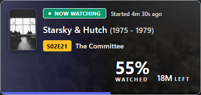

# MediaTrail

[🇺🇸 English description (README in English)](README.md)

Saját üzemeltetésű személyes médiakatalógus és napló mindarról, amit megnézel, elolvasol vagy végigjátszol.

[](https://github.com/aicon/MediaTrail/releases)
[](LICENSE)
[](https://github.com/aicon/MediaTrail/pkgs/container/mediatrail)
[](https://aicon.github.io/mediatrail-docs/hu/)
[](https://ko-fi.com/aiconwg)

---

A MediaTrail egy önálló, saját szerveren futtatható webes alkalmazás filmek, sorozatok, évadok, epizódok, animék, mangák, videojátékok, könyvek, képregények és társasjátékok naplózására. Rendszerezd a gyűjteményedet, jegyezz fel dátumokat, értékelj pontszámmal, kövesd a haladásodat, készíts egyéni listákat és böngészd a részletes statisztikákat.

A projekt a [Yamtrack](https://github.com/FuzzyGrim/Yamtrack) független forkjaként indult, olyan hiánypótló funkciókkal kiegészülve, mint a beépített REST API, a részletes epizód-előzmények, a valós idejű lejátszáskövetés, a Nuvio-integráció és a teljes magyar nyelvű felület.

---

## Főbb funkciók

- **Napló mindenhez:** Filmek, sorozatok, anime, manga, videojátékok, könyvek, képregények és társasjátékok. Pontszám, állapot, haladás, ismétlések, kezdő- és záródátum, jegyzet.
- **Évadok, és minden megtekintés:** Minden évad külön követhető. Egy epizódhoz több megtekintés is rögzíthető, saját dátummal és jegyzettel. A filmek és a sorozatok külön maradnak.
- **A változtatások előzménye:** Megmarad, mikor vetted fel a tételt, mikor kezdted el, és mikor nézted vagy olvastad újra.
- **Ami nincs a katalógusban:** Kézi tétel, ha egyik támogatott forrás sem ismeri.
- **Közös listák:** Személyes lista bármilyen célra, más fiókok meghívásával.
- **Közelgő megjelenések:** Naptár a soron következőkről, iCalendar (`.ics`) hivatkozással más naptárprogramokhoz. Értesítés Apprise-on (Discord, Telegram, ntfy, Slack, e-mail és mások).
- **Külön fiókok:** Mindenkinek saját könyvtára van. A belépés lehet a MediaTrail sajátja, vagy OIDC és közösségi szolgáltató (Google, GitHub, Discord és mások) a django-allauthon keresztül.
- **Magyar és angol felület:** A nyelv fiókonként választható. A TMDB címei a `TMDB_LANG` beállítást követik.
- **Import, benne a Nuvio:** A Nuvio csak az új tételeket veheti fel, vagy a már követetteket frissítheti, titkosított hitelesítő adatokkal és ütemezéssel. A Trakt, a SIMKL, a MyAnimeList, az AniList és a Kitsu szintén ütemezhető. Az ingyenes Trakt-fiók csak két alkalmazást enged az API-ra kötni. A zárt import meghagyja a jelenlegi Trakt-belépést, és választható mellé az új, eszközkódos API (`TRAKT_API_PKCE`). A teljes könyvtár CSV-be menthető és vissza is tölthető; IMDb-, Goodreads-, Steam- és HowLongToBeat-lista is behozható.
- **Lejátszás, benne a Nuvio:** A kezdőlapon a „Most nézem” sáv mutatja a pozíciót, az eltelt és a hátralévő időt, amikor egy [Nuvio-s társalkalmazás](#kapcsolódó-alkalmazások) jelzi, mit játszol. A Jellyfin, a Plex és az Emby a frissen megnézett médiát magától is be tudja jelölni.
- **REST API (Preview):** Modern API a `/api/v1/`, OpenAPI séma a `/api/schema/`, valamint interaktív Swagger dokumentáció a `/api/docs/` címen. Írott leírás: [API_HU.md](API_HU.md) ([English](API.md)).
- **Egy konténer:** Docker Compose, SQLite vagy PostgreSQL. A Redis a képen belül fut, az adat egy csatolt mappában marad.

---

## Előnézet: „Most nézem” sáv

A MediaTrail a kezdőlapon azonnal megjeleníti az éppen lejátszott tartalmat:


*(Kompakt nézetben is elérhető a kisebb kijelzőkhöz)*



A sáv a kezdőlap tetején van, a könyvtár fölött:


> **Megjegyzés:** A „Most nézem” sávhoz [kapcsolódó alkalmazás](#kapcsolódó-alkalmazások) kell. Akkor jelenik meg, amikor az alkalmazás jelzi, mit játszol.

---

## Gyors indítás

A MediaTrail egyetlen kész, beépített Redis-t tartalmazó Docker konténerként futtatható.

### Docker Compose

Hozz létre egy `docker-compose.yml` fájlt:

```yaml
services:
  mediatrail:
    image: ghcr.io/aicon/mediatrail:latest
    container_name: mediatrail
    restart: unless-stopped
    ports:
      - "8000:8000"
    environment:
      SECRET: longstring
      TMDB_LANG: hu
      TMDB_API:
      TVDB_API:
      URLS:
      ADMIN_ENABLED: false
      REGISTRATION: false
    volumes:
      - ./db:/mediatrail/db
```

### A környezeti értékek cseréje

Nyisd meg a Compose fájlt, és cseréld le a példa titkot:

```text
SECRET=longstring
```

A `SECRET` legyen hosszú, véletlen érték. Ha a MediaTrail fordított proxy mögött fut, a `URLS` a nyilvános cím:

```text
URLS=https://mediatrail.example.com
```

A cím tartalmazza a protokollt (`https` vagy `http`), és ne legyen a végén perjel vagy alkalmazásútvonal. Több cím vesszővel választható el.

A támogatott beállítások teljes listája: [Környezet](https://aicon.github.io/mediatrail-docs/hu/runtime/).

Indítsd el a konténert:

```bash
docker compose up -d
```

Nyisd meg a böngészőben a `http://localhost:8000` címet.

> **Yamtrackről váltasz?**  
> A MediaTrail konténeren belüli adatútvonala a korábbi `/yamtrack/db` helyett `/mediatrail/db`. Elég a meglévő helyi adatkönyvtáradat átcsatolni a fent látható módon: `./db:/mediatrail/db`.

---

## MediaTrail vs. Yamtrack

A MediaTrail egy független, nem hivatalos fork; **nem áll kapcsolatban az eredeti Yamtrack fejlesztőivel**.

### Miért készült a fork?
A MediaTrail alapja a Yamtrack `dev` ága a `v0.25.3` kiadás utánról (a 2026. július 12-i füles részletes oldal), amelybe beolvasztásra került a `#1378`-as REST API és a `#1608`-as epizód-előzmény munka.

Amikor a hivatalos Yamtrack átállt a `0.26`-os ágra, a MediaTrail szándékosan a bevált `0.25.x` ágon maradt a stabilitás, az önálló működés és a saját funkciók (pl. Nuvio) zavartalansága érdekében. A Yamtrack újabb részeiből szándékosan kimaradt az átírt naplóoldal, a statisztika újrarajzolása és a Trakt zip-import.

| Funkció | Hivatalos Yamtrack (Stabil) | MediaTrail |
| :--- | :---: | :---: |
| **REST API** (`/api/v1/`) | Nincs | Van |
| **Többszöri Epizód-előzmény** | Nincs | Van |
| **Élő „Most nézem” sáv** | Nincs | Van |
| **Nuvio szinkronizáció / import** | Nincs | Van |
| **Magyar nyelvű felület** | Nincs | Van |
| **Beépített belső Redis** | Nincs *(Külön Redis kell)* | Van *(A konténerben fut)* |
| **Belső Python csomagnév** | `yamtrack` | `yamtrack` *(megtartva a stabilitásért)* |

---

## Kapcsolódó alkalmazások

A MediaTrailhez külön segédprogramok érhetők el a lejátszási események automatikus szinkronizálásához (scrobble):

| Név | Leírás |
| :--- | :--- |
| **[MediaTrail-Scrobbler](https://github.com/aicon/MediaTrail-Scrobbler)** | Háttérszolgáltatás, amely a Nuvio lejátszási eseményeit írja a MediaTrailba. (`ghcr.io/aicon/mediatrail-scrobbler`) |
| **[NuvioTV-MT](https://github.com/aicon/NuvioTV-MT)** | Tévére szabott Nuvio kliens saját példánya, beépített MediaTrail scrobblerrel. |
| **[NuvioMobile-MT](https://github.com/aicon/NuvioMobile-MT)** | Mobil Nuvio kliens MediaTrail támogatással. |

---

## Dokumentáció

A részletes felhasználói kézikönyv külön felületen érhető el:

- **Kézikönyv:** [https://aicon.github.io/mediatrail-docs/hu/](https://aicon.github.io/mediatrail-docs/hu/)
- **API-leírás:** [API_HU.md](API_HU.md) · [API.md](API.md)

A kézikönyv fejezetei: *Telepítés, Könyvtár, Import (benne a Nuvio), Környezet, Fiókok, Karbantartás.*

---

## Támogatás

Ha hasznosnak találod a MediaTrailt és szeretnéd támogatni a fejlesztést és karbantartást:

[](https://ko-fi.com/aiconwg)

---

## Licenc és AGPL-3.0

A MediaTrail nyílt forráskódú szoftver a **GNU Affero General Public License v3.0 (AGPL-3.0)** alatt.  
A Yamtrack eredeti szerzői jogi jelzései megmaradtak. A MediaTrail saját kiegészítő nyilatkozata a `NOTICE` fájlban olvasható.

### Hálózati használat (AGPL-3.0 13. szakasz)
Amennyiben a programot hálózaton keresztül (több felhasználó számára) üzemelteted, a licenc megköveteli a futó pontos verzió forráskódjának nyilvános felkínálását:
- Állítsd be a `MEDIATRAIL_SOURCE_URL` környezeti változót a futó verzió publikus HTTP(S) forráskód-címére, mielőtt mások számára elérhetővé tennéd.
- Saját gépen futó, privát tesztpéldány esetén a változó üresen hagyható.