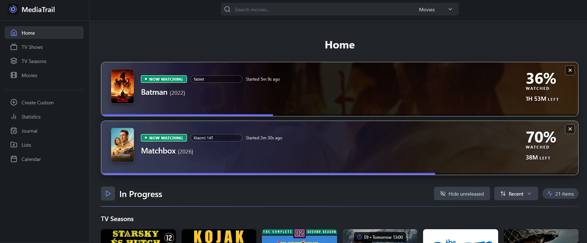

# Library

[Magyar változat](hu/library.md)

The home page and the sidebar are the library. Movies, series, seasons, and the other types each have their own list. Search on a list looks through that person's entries.

While a title is playing or paused, **Now Watching** strips can sit at the top of the home page — one strip per companion device (phone, each TV). Each strip shows the title, the episode, how much is already watched, the time left, and a device label you can rename. Dismiss or stop on one device leaves the others alone. When the companion sends `stop` at **90%** or more, the MediaTrail addon saves one finished watch.

Install the MediaTrail addon address from Settings → Integrations → Nuvio in each [NuvioMobile-MT](https://github.com/aicon/NuvioMobile-MT) or [NuvioTV-MT](https://github.com/aicon/NuvioTV-MT) client. Details: [Live playback / Now Watching](now-watching.md). Two-way watch-history sync (mark watched / unwatched) is optional on the same Integrations page; see [Imports → Nuvio](imports.md#two-way-interactive-sync).

### Lists and Nuvio Library

The **Lists** sidebar holds custom collections (including a designated **watchlist** for optional two-way sync with the Nuvio Library). Details: [Imports → Nuvio Library watchlist sync](imports.md#nuvio-library-watchlist-sync). Sync pushes one canonical library id and, on series leave, removes every id variant plus any sticky Season cards in Nuvio. The tokened MediaTrail addon also publishes those lists as catalog shelves for Nuvio / aiometadata.

### In Progress resume

When you pause or stop a **movie** between about **2%** and **90%**, MediaTrail keeps it under home **In Progress** with a resume progress bar (delete the card to dismiss). The same mid-watch range for an **episode** updates that **season’s** In Progress card: a bottom poster pill shows `E… • …%`, and the progress bar follows the resume point. Finishing the episode (companion `stop` at ≥ **90%**), marking it watched, or leaving In Progress clears the resume.

Home **Recent** sort also uses the last resume update, so a mid-watch stop can move that card up. When every episode in a season is watched, MediaTrail marks the season **Completed** and clears any leftover resume; an already-Completed season is left alone.

Opening a title shows the catalog details and the tracking form. Status, score, progress, start and end dates, and a note belong to that entry. Repeating a finished title keeps another pass in the history. A series is a parent: seasons and episodes are separate rows, so marking one episode does not rewrite the whole show.

### External links and recommendations

On movie and TV detail pages, Preferences controls which external profile links appear (IMDb, Wikidata, Letterboxd, TVDB, Trakt, Port.hu).

The Recommendations tab is a selectable hybrid: turn on any combination of TMDB, IMDb “More like this”, and optional Gemini AI. Defaults are under Preferences → Recommendation sources; the same engines can be toggled on the page with source pills. Selected sources merge into one deduplicated list of TMDB cards, each showing which engines suggested it. The page paints TMDB first, then loads IMDb/AI in the background. Titles you already completed or marked In Progress never appear. AI needs your own Gemini API key under Settings → Integrations → Gemini (stored encrypted). IMDb and AI responses are cached in the durable SQLite database for 30 days.

### Custom-list membership badge

When a title is already on one of your custom lists, poster cards and detail pages show the same dark rounded status chip on the top-right as the left status badge, with the bookmark glyph in coral (`#f97316`). The left planning chip stays sky-colored.

## Language

Preferences has the interface language, English or Hungarian. It is stored on the account. Catalog text from outside services can still arrive in the language those services were asked for. `TMDB_LANG` is that request language for movie and series metadata. See [Runtime](runtime.md).

## Custom entries

Some titles are not in the catalogs. **Custom entry** in the sidebar creates one by hand: type, title, and an optional image address. It then behaves like any other tracked item.

## Lists

Lists are collections you name yourself. A list can include mixed types, and you can invite another account on the same MediaTrail to collaborate. The list search and the sort order are on the list page.

## Calendar

The calendar collects upcoming releases from the library. The export link on that page is a private address for another calendar application. It contains your personal token. If you regenerate the token under Settings, the old link stops working, and so do the player webhooks that use the same token.

## Statistics

Statistics summarizes statuses, activity, and the range you pick, from today back to the whole history. The labels follow the interface language.

## Notifications

Settings, then Notifications, takes one Apprise address per line. Release reminders and the daily digest go out through those addresses. The in-page help names the address shapes Apprise accepts.
